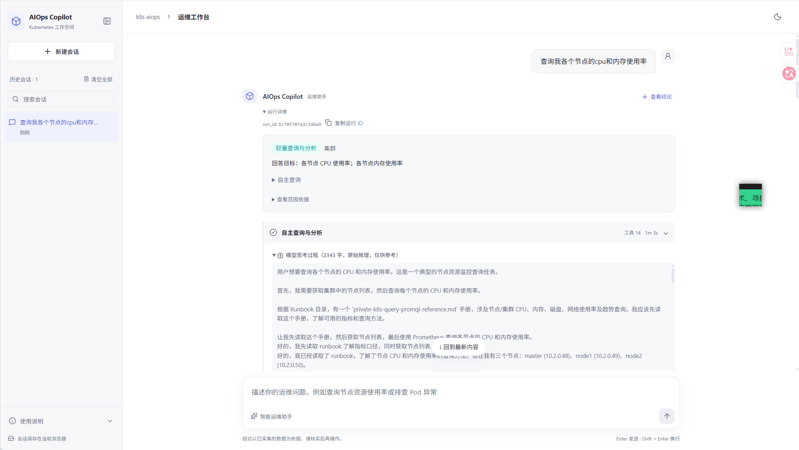
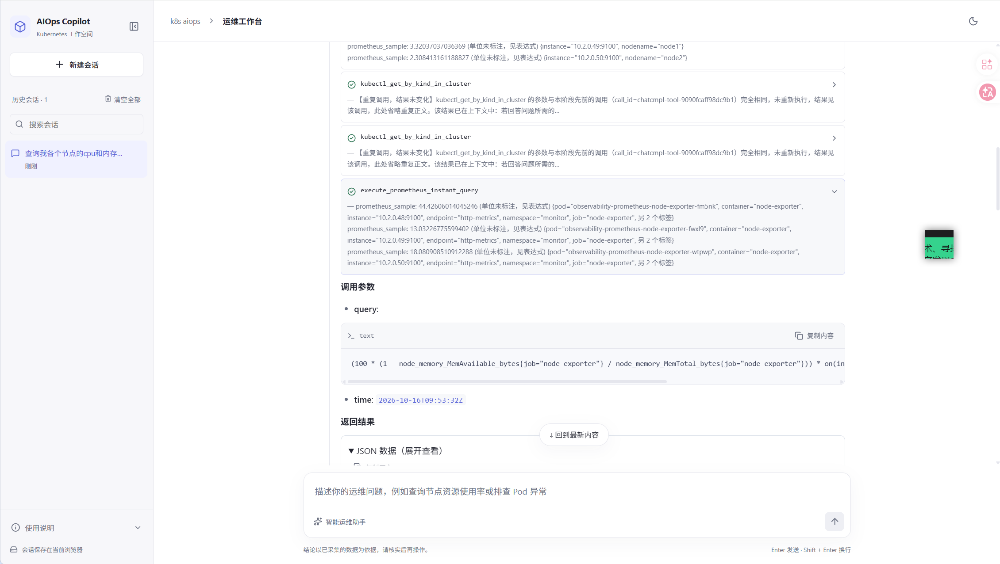
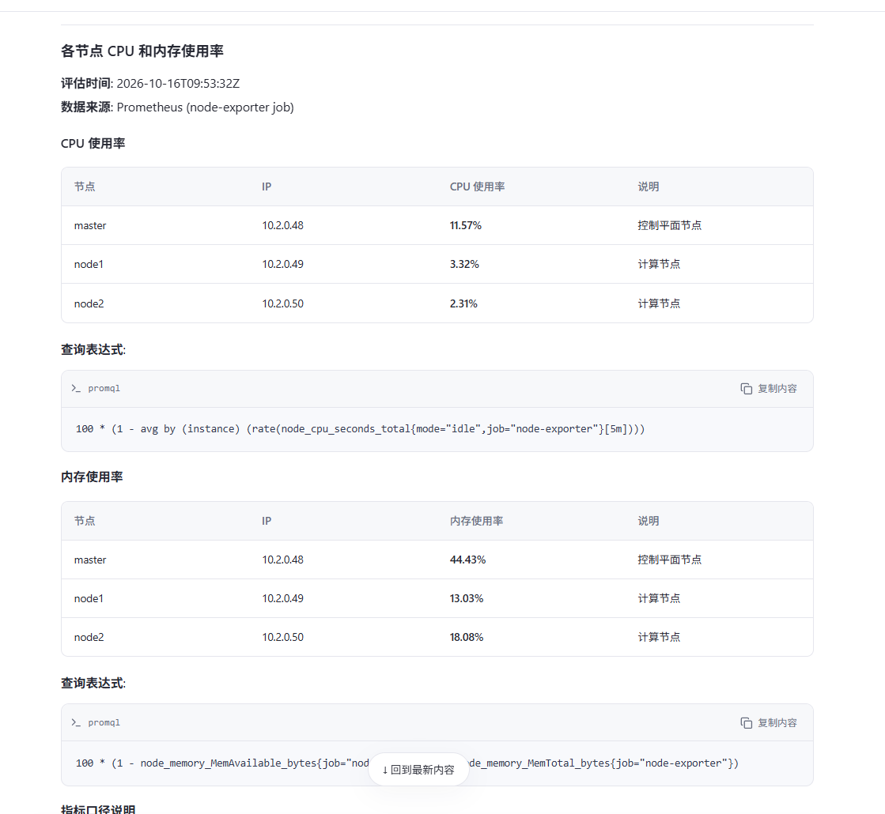
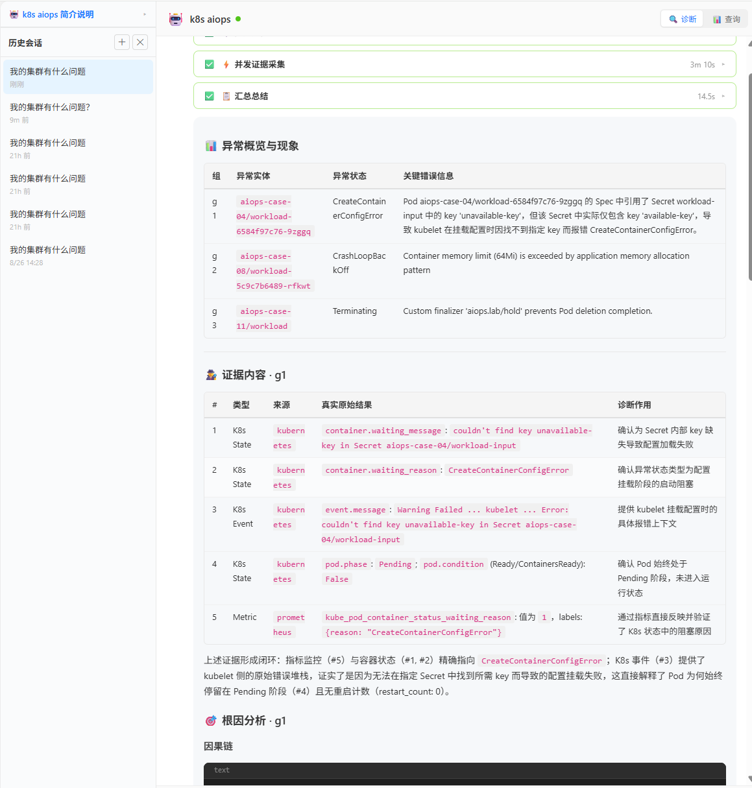
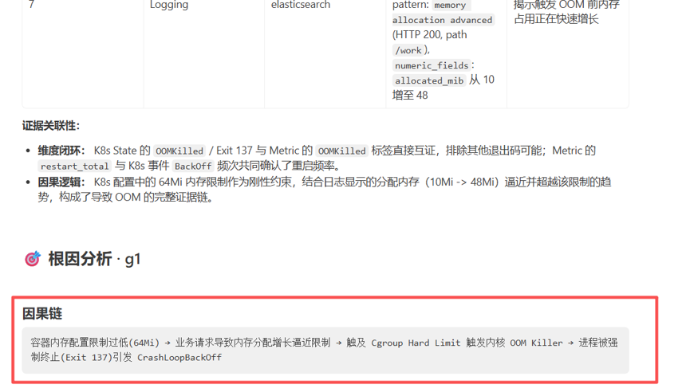
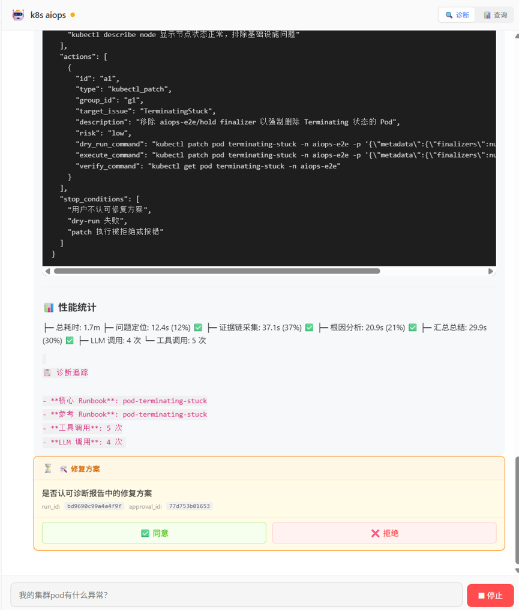
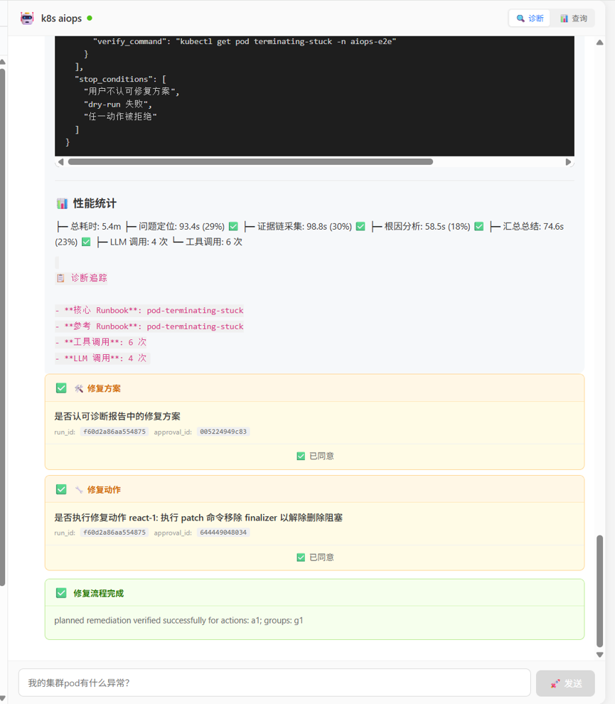

# K8s AIOps Copilot

[English](README.en.md) | **中文**

面向 Kubernetes 的智能运维诊断助手。使用自然语言查询集群，按异常 Pod 独立采集现场证据，再生成包含现象、根因、依据和未知项的诊断报告。

## 项目背景

Kubernetes Pod 排障需要结合资源状态、事件、日志、指标和链路信息，证据分散在多个工具与可观测性系统中。本项目通过自然语言交互组织查询和诊断，减少手动切换工具与汇总证据的工作。

## 核心功能

- **异常诊断**：调度、镜像、挂载、配置、CrashLoop、OOM、探针及删除阻塞等 Pod 故障。
- **三维可观测性**：通过 MCP 查询 Metrics、Logging、Tracing；支持按调查目的组合 PromQL、日志过滤和链路条件。
- **多对象分析**：自主深度诊断识别多个目标时分组并行取证和 RCA，再汇总；单目标直接进入取证与 RCA，复用相同阶段实现。
- **证据可回查**：工具响应、结构化结果和模型摘要分别归档，支持按引用补读。
- **对外接入**：HTTP/SSE、可选聊天前端、联邦多集群及标准 A2A Adapter。
- **运行可诊断**：每次运行产出账本与工程异常发现（重复调用、步数/时限、模型服务错误、上下文压缩等），`GET /runs/{run_id}` 一分钟看懂时间花在哪、哪个护栏触发；详见[运行诊断](docs/run-diagnostics.md)。
- **小模型护栏**：工具循环内重复调用不执行只提示、单轮调用数与重复次数有上限、输出预算按调用类型配置、工具循环内 reasoning 回传；全部是配置项，不含任何按故障类型或指标名的特判。

Agent 负责规划和解释，MCP 查询真实数据，Runbook 提供排障知识。

## 效果展示

以下为实际运行截图，展示从自然语言查询、故障诊断到人工审批修复的使用流程。不同截图的界面样式可能有所差异，具体以部署版本为准。点击图片可查看原图。

### 自然语言查询与资源使用率

输入“查询我各个节点的 CPU 和内存使用率”，查看查询目标、运行详情和分析过程。



展开工具调用，查看 Prometheus 查询参数与返回结果，追溯结论的数据来源。



最终按节点汇总 CPU、内存使用率，并展示对应的 PromQL 查询表达式。



### 异常诊断与根因分析

汇总多个异常 Pod 的状态与关键信息，按组展示 Kubernetes 状态、事件和监控指标等现场证据。



结合容器内存限制、日志和指标，展示从内存增长到 OOM、进程退出及 CrashLoopBackOff 的因果链。



### 人工审批与修复结果

诊断后展示修复方案、执行与验证命令，以及阶段耗时和调用统计，由用户审阅并批准修复方案。



修复方案和具体动作分别审批后，展示执行后的验证结果；图中为解除 finalizer 删除阻塞的修复流程完成示例。



## 配套项目与可观测性组件


| 项目 / 组件                                           | 职责                                                                           |
| ------------------------------------------------- | ---------------------------------------------------------------------------- |
| 本仓库                                               | FastAPI + LangGraph 诊断服务及 A2A Adapter                                        |
| [MCP 工具服务](http://10.2.0.86/wanghuhu/mcpstander)  | Kubernetes 与可观测性查询接口                                                         |
| [可观测性组件](http://10.2.0.86/platform/observability) | Prometheus 指标、Filebeat/Elasticsearch 日志、DeepFlow/ClickHouse 流量、Tempo 应用 Span |
| [聊天前端](http://10.2.0.86/wanghuhu/aiops-frount)    | 展示诊断进度、工具结果和报告，可选部署                                                          |


以上链接为内网仓库，需要相应网络和访问权限。先部署可观测性组件并确认数据入库，再按 MCP 仓库说明配置后端连接。MCP 不负责安装采集器；应用 Span 还需要埋点和链路上下文传播。

## 快速开始：复制命令部署

以下命令用于本文内网环境：节点地址 **10.2.0.48**，三个仓库统一下载到 **~/aiops-workspace**。在同一个 Bash 终端中依次复制执行，每一步成功后再进行下一步。

前提：Git/SSH 权限、kubectl 集群访问、私有镜像拉取和存储已就绪；[可观测性组件](http://10.2.0.86/platform/observability)已部署，MCP 仓库的后端配置与现场一致。其他环境必须先调整地址和连接配置。

Agent 的 `make deploy` 会使用 `VERSION` 对应的主服务和 A2A 两个镜像。若该版本尚未完整发布，先执行文末的 `make build`、`make push`；仅发布主服务镜像不满足完整部署的前提。

重部署使用 **make delete deploy**：先删除再部署对应服务，期间服务中断。诊断或测试运行期间禁止重部署。首次部署可使用 make deploy，不加 -j。

### 1. 下载并部署 MCP

```bash
mkdir -p ~/aiops-workspace
```

```bash
cd ~/aiops-workspace
```

```bash
git clone http://10.2.0.86/wanghuhu/mcpstander.git
```

```bash
cd ~/aiops-workspace/mcpstander
```

```bash
make delete deploy
```

```bash
kubectl get pods,svc -n mcp
```

等待 mcp-server-manager 部署完成且 Pod Ready，再继续。镜像、后端和权限配置见 [MCP 仓库](http://10.2.0.86/wanghuhu/mcpstander)。

### 2. 下载并部署 Agent

```bash
cd ~/aiops-workspace
```

```bash
git clone --branch qwen-before-architecture ssh://git@10.2.0.86:9922/wanghuhu/holmegpt-agent.git
```

```bash
cd ~/aiops-workspace/holmegpt-agent
```

首次部署前，按[模型配置说明](docs/GUIDE.md#2-agent-配置)准备 `deploy/secrets/core.yaml`，填写模型名称、API Base、API Key 和上下文容量；已有配置保留，不提交真实凭据。单集群在 [config.yaml](deploy/configmap/config.yaml) 设置 `federation.enabled: false`，并核对 MCP 地址。

```bash
make delete deploy A2A_PUBLIC_HOST=10.2.0.48
```

```bash
kubectl get pods,svc,pvc -n aiops
```

```bash
curl -fsS http://10.2.0.48:30800/health
```

```bash
curl -fsS http://10.2.0.48:30800/api/v1/mcp/status
```

预期 aiops-copilot 为 2/2 Ready，PVC 为 Bound。健康接口可达不代表全部可观测后端正常，需同时检查 MCP 状态。

### 3. 下载并部署前端

```bash
cd ~/aiops-workspace
```

```bash
git clone ssh://git@10.2.0.86:9922/wanghuhu/aiops-frount.git
```

```bash
cd ~/aiops-workspace/aiops-frount
```

```bash
make delete deploy
```

```bash
kubectl get pods,svc -n aiops
```

部署完成后，浏览器打开 **[http://10.2.0.48:30081](http://10.2.0.48:30081)**。


| 入口             | 地址                                                                                                       |
| -------------- | -------------------------------------------------------------------------------------------------------- |
| 聊天前端           | [http://10.2.0.48:30081](http://10.2.0.48:30081)                                                         |
| Agent API      | [http://10.2.0.48:30800](http://10.2.0.48:30800)                                                         |
| A2A Agent Card | [http://10.2.0.48:30801/.well-known/agent-card.json](http://10.2.0.48:30801/.well-known/agent-card.json) |


### 4. 创建异常测试 Case

回到 Agent 仓库。下面先部署 c08 OOMKilled：

```bash
cd ~/aiops-workspace/holmegpt-agent
```

```bash
make case-deploy CASE=c08
```

```bash
kubectl get pods -n aiops-case-08
```

也可以再部署 c04，体验两个异常 Pod 同时存在时的分组诊断：

```bash
make case-deploy CASE=c04
```

```bash
kubectl get pods -n aiops-case-04
```

常用基础 Case：


| Case | 预期异常状态 / 现象                       | 主要原因                        |
| ---- | --------------------------------- | --------------------------- |
| c01  | Pending / FailedScheduling        | 节点选择器无匹配节点                  |
| c02  | ImagePullBackOff                  | 镜像仓库域名不可解析                  |
| c03  | FailedMount                       | 卷引用的 ConfigMap 不存在          |
| c04  | CreateContainerConfigError        | 环境变量引用的 Secret key 缺失       |
| c05  | FailedCreatePodSandBox            | Multus 网络附件缺失，需要预先安装 Multus |
| c06  | CrashLoopBackOff / exit 2         | 应用运行时非零退出                   |
| c07  | 配置错误 / HTTP 500 / Trace / exit 78 | 应用配置缺失后退出                   |
| c08  | OOMKilled / exit 137              | 应用内存增长超过容器 limit            |
| c09  | Running、Ready=False / HTTP 503    | Readiness 检查失败              |
| c10  | Liveness 失败 / 反复重启                | 健康检查端点返回 HTTP 500           |
| c11  | Terminating                       | finalizer 阻止对象删除            |


### 5. 发起一次诊断

```bash
curl --no-buffer -G "http://10.2.0.48:30800/ask"  --data-urlencode "q=当前集群有什么问题？"
```

或打开前端，输入同样的问题。预期先看到问题定位和取证进度，最终报告列出异常 Pod、证据、根因与未知项；多个异常按组展示。具体结果取决于现场数据及模型分析，不保证每次判断都正确。

### 6. 完成体验后清理 Case

仅清理本次部署的测试环境；删除对应 namespace 内资源，不影响 aiops 和 mcp 服务：

```bash
cd ~/aiops-workspace/holmegpt-agent
```

```bash
make case-clean CASE=c08
```

```bash
make case-clean CASE=c04
```

## 其他使用方式

### 执行命令与 Pod 修复（默认人工审批）

两条路径，职责分开：

- **执行明确的命令**（如"卸载 default/cloud-server""在 xx Pod 里执行 ls /tmp""helm list"）：走轻量路由 `focused/operate`，Agent 直接执行，之后最多做一次只读确认，不制定修复方案、不弹审批卡。高危命令规则是唯一的闸门，执行与拦截都写审计。
- **修复已诊断的异常**（报告下"生成修复方案"，或会话中说"修复刚才的问题"）：按异常组并发规划，每组一个独立任务；方案中的命令先过高危规则，再按执行方式审批后执行，最后进入恢复观察（已恢复 / 超时未恢复 / 待复查）。

**执行方式**：`workflow.remediation.mode: review`（默认，每个动作人工审批，超时取消而非自动批准）或 `auto`（自动执行，仅限受控环境）。管理员可凭 Secret 中的 `AIOPS_ADMIN_TOKEN` 调 `PUT /repair/policy/mode` 做有时限的运行时切换，变更写审计。

**高危命令规则**（网页修复区"查看拦截规则"，`GET /repair/policy` 可查，`POST /repair/policy/check` 可干跑）分三类，规划、执行、对话三条路径使用同一套：

| 类别 | 内容 | 处理 |
|---|---|---|
| 绝对禁止 | Kubernetes：`taint`、`edit`、`cp`、`port-forward` 等；写节点、CRD、集群角色等集群级资源；`--all`/`-A` 批量操作。Shell：`dd`、`mkfs`、`reboot`、`shutdown` 等 | 任何情况都不执行，拒绝时带规则名 |
| 需人工审批 | `drain`、删除/修改命名空间、Pod 内 `rm` | 对话中拦截；修复方案中可用，执行前强制人工审批，**自动执行模式也一样** |
| 普通修复动作 | `delete pod`、`patch`、`set env`、`rollout restart`、`scale` 等 | 按执行方式审批或自动执行，仍受"只改本组对象及其控制器"的范围校验 |

MCP 的 bash 工具另有一道闸，Agent 自己执行不了 Shell 禁止命令和 `rm`；经批准的高危命令由后端修复执行器执行。验收步骤见[高危命令黑名单验收](docs/acceptance-blacklist.md)，生命周期与边界见[核心流程与模块架构](docs/ARCHITECTURE.md)第 5 节。

命令成功不等于根因已消除，仍需结合恢复观察复查。审批和修复互斥状态为进程内存，Pod 重启后需重新发起；不要据此部署多副本修复执行器。AIOps/MCP 的 Kubernetes RBAC 为集群管理权限，这是凭据层权限，不取消上述命令规则和人工审批。

`/query` 与 `/ask` 先由 Agent 理解意图并输出 JSON 路由：日常查询和快速初查由查询 Agent 直接生成结构化答案，不再调用独立总结模型；Pod、命名空间或集群根因诊断走“定位 → 取证 → 根因 → 总结”，多个 Pod 可分组并发取证和分析。深度诊断不等于全量扫描，各节点围绕原问题自主选择只读工具和 Runbook，不执行固定采集兜底。前端显示 Markdown，SSE 的 `query_answer` 包含意图、范围、状态、正文、来源与缺失项；结构正确不代表诊断已核验。两接口共享 session_id 会话记忆及 54k 环境配置下的自动上下文压缩；进程内记忆在 Pod 重启后丢失。

```bash
curl -N -G "http://10.2.0.48:30800/query" --data-urlencode 'q=查询 xnet 命名空间下所有 Pod 的日志'
```

```bash
curl -N -G "http://10.2.0.48:30800/query"  --data-urlencode 'q=各节点当前 CPU 和内存使用率是多少？'
```


## 更新与重部署

推荐一条命令完成发布：`VERSION` 加一后执行 `make release`（构建并推送镜像，再滚动更新部署；就绪探针 `/ready` 通过后旧 Pod 才退出，滚动失败自动回滚并打印新 Pod 日志，不再先删后建）。

修改代码时，在对应仓库更新 VERSION，再按顺序执行：

```bash
make build
```

```bash
make push
```

```bash
make deploy
```

make deploy 本身不会构建镜像。Agent、MCP、前端分别构建发布，不能只更新其中一个仓库的 VERSION 就认为三个服务均已升级。

已有测试环境需要先删除服务再部署时，可在对应仓库执行：

```bash
make delete deploy
```

注意 make 为小写；此操作会中断对应服务，不是首次部署或常规升级的必需步骤，不要加 -j 并行执行。Agent 的 make delete 保留报告 PVC；MCP、前端删除范围以各自 Makefile 为准。不要在运行诊断或质量测试时重部署。

日志、联邦部署和详细排查见[部署指南](docs/GUIDE.md)；后台质量测试和断点续跑见[质量测试说明](test/aiops_quality_e2e/README.md)。

## 核心文档

| 文档 | 内容 |
|---|---|
| [核心流程与模块架构](docs/ARCHITECTURE.md) | 从用户输入到修复与恢复观察的完整生命周期、数据契约、工具结果处理、上下文压缩、边界与已知限制 |
| [HTTP API](docs/api.md) | curl 完成查询、深度诊断、修复、审批与观察的完整流程；A2A 与 API 身份待办 |
| [部署与运维](docs/GUIDE.md) | 配置、发布、权限、联邦及常见排查 |
| [运行诊断](docs/run-diagnostics.md) | 每次运行的账本、工程异常分类、`/runs/{run_id}` 报告 |
| [LLM 自身异常记录](docs/llm-model-anomalies.md) | 模型/推理服务自身问题的现象与外部佐证 |
| [高危命令验收](docs/acceptance-blacklist.md) | 黑名单与需人工审批命令的标准验收步骤 |
| [多集群设计](docs/multi-cluster-design.md) | 多集群与新旧可观测后端适配的设计稿：边界、架构、改动清单、阶段与验收（未实现） |
| [多集群验收方案](docs/multi-cluster-acceptance.md) | 多集群功能的分支与版本规划、测试分层、验收脚本和逐阶段用例 |
| [修复三个 Sprint](docs/remediation-sprint-design-2026-10.md) | 修复链路需求、设计与验收记录 |
| [可观测性采集](docs/observability.md) | MCP 工具、PromQL 示例、日志与链路、结果含义 |
| [A2A](docs/a2a.md) | 标准协议、客户端、鉴权与真实 Agent-to-Agent 测试 |
| [环境变量](docs/configuration-env.md) | 由 `scripts/list_env_vars.py` 生成 |
| [异常环境](test/pod-anomaly-cases/README.md) | 故障部署、验证和安全清理（`make case-*` / `make repair-cases-*`） |
| [质量测试](test/aiops_quality_e2e/README.md) | 单场景、多根因、四项指标与报告 |

历史过程记录、旧交接文档已从仓库移除，可通过 git 历史（标签 `baseline-20261019-run-3c052423` 之前）回溯。

## 开发

Python 3.12（与镜像一致）。运行时依赖 `requirements.runtime.txt`（HolmesGPT 由 Dockerfile 单独安装），开发工具 `requirements.dev.txt`，A2A 依赖 `requirements.a2a*.txt`（独立虚拟环境 `.venv-a2a`）。

```sh
make check          # 语法 + lint（ruff E9/F/I/B）+ 格式检查 + 单元测试
make test-unit      # 仅单元测试（tests/unit）
make test-a2a       # A2A 测试（需 .venv-a2a）
make release        # 构建并推送镜像后滚动部署
```

目录：`app/` 服务代码，`a2a_adapter/` A2A 适配器，`a2a_test_agent/` A2A 测试 Agent，`deploy/` K8s 清单与配置，`tests/` 自动化回归，`test/` 故障环境与质量评测工具，`scripts/` 运行报告、环境变量文档生成与验收脚本，`tools/` 命令行客户端，`config/examples/` Secret 示例。提示词只从 `app/core/prompts.py` 引入；修改提示词需配套行为测试。

报告和工具归档默认写入 Pod 内的 `/tmp/aiops/reports`（PVC）。源码实现与当前线上版本可能不同，历史测试成绩不能直接代表当前部署效果。

## License

项目自有代码采用 [Apache License 2.0](LICENSE)，允许商业使用。
第三方代码与依赖保留各自的许可证及署名，不由本项目重新授权。
